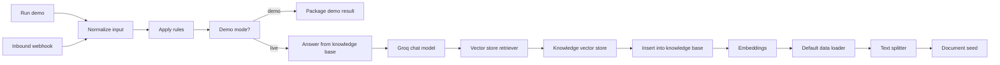

# RAG knowledge-base chatbot

> Portfolio demo only. This workflow is an original example for demonstration. It is not client work and it does not represent a deployment for any customer.

| | |
| --- | --- |
| Category | `ai-agents` |
| Difficulty | advanced |
| Apps | Chat, Groq, Gemini embeddings, Vector store |
| Time saved | Repeated how-to answers, and fewer invented policy replies |
| Demo status | Run **Run demo** in n8n. The live apps stay on the false branch until you send `demo: false`. |

## Problem

Support answers from memory, and the help center is a folder nobody searches.

## Who it is for

Teams who want a grounded chatbot and need to see the n8n nodes before they pick Pinecone or Supabase.

## What the workflow does

A question is answered from a tiny local knowledge set in demo mode. The live branch is a retrieval chain: Gemini embeddings, an in-memory vector store, a retriever, and a Groq chat model. An insert path is on the canvas for loading documents.

The checked-in sample is the contract. **Apply rules** turns that payload into a `summary`, a `route`, a `record` for the destination apps, and an `actions` list describing each write the live branch would make. **Package demo result** returns that object when `demo` is true, which is the default.

## Estimated time saved

Repeated how-to answers, and fewer invented policy replies. The figure assumes the sample's volume and a person who currently does the same triage by hand. It is a planning number for a portfolio review, not a measured client result.

## Node by node

1. **Overview.** Sticky note with the portfolio-demo disclaimer and how to run the offline path.
2. **Run demo.** Manual trigger used by the editor and by `n8n execute`. With no payload, the next node loads the sample.
3. **Inbound webhook.** Production-style POST webhook at `/webhook/rag-knowledge-base-chatbot`. Responds with the last node's JSON.
4. **Normalize input.** Fills any missing fields from the checked-in sample and forces an explicit demo flag. An empty manual run therefore always has something valid to score.
5. **Apply rules.** Keyword retrieval over three articles. The sample hits the refund article. The live chain replaces this lookup.
6. **Demo mode?.** Routes to the offline result while `demo` is true. The live apps run only when a caller sends demo:false.
7. **Package demo result.** Shapes the object returned to the editor, the CLI, and the webhook: summary, route, record, and the actions the live branch would have taken.
8. **Answer from knowledge base.** Question-and-answer chain. It only runs when demo mode is off.
9. **Groq chat model.** Chat model for the retrieval chain. Gemini or Claude can replace this node.
10. **Vector store retriever.** Turns the in-memory vector store into the retriever the Q&A chain expects.
11. **Knowledge vector store.** Simple Vector Store in retrieve mode. Swap it for Supabase or Pinecone when the corpus outgrows one process.
12. **Insert into knowledge base.** Insert path for the same memory key. Feed it documents before asking questions in production.
13. **Embeddings.** Gemini embeddings shared by the retrieve and insert stores. Any other embeddings node can replace it.
14. **Default data loader.** Loads the documents array on the item. Point jsonData at your crawled pages or help-center export.
15. **Text splitter.** Recursive splitter, 800 characters with 120 overlap. Raise chunk size for policy PDFs.
16. **Document seed.** Splits a documents array into items for the insert store. Not connected to the demo branch, so tests do not embed anything.

## Diagram



## Sample input

Save as the webhook body, or rely on the manual trigger, which loads the same object from **Normalize input**.

```json
{
  "demo": true,
  "question": "What is your refund policy?",
  "prompt": "What is your refund policy?",
  "documents": [
    {
      "text": "Refunds are available within 14 days."
    }
  ]
}
```

The file next to this README, `sample-input.json`, is the same payload.

## Setup

1. Import `workflow.json` with n8n's Import from File. The workflow arrives inactive.
2. Select **Run demo** and execute it. **Package demo result** returns `status: demo_ready` plus the summary, route, record, and actions.
3. Create each credential listed below in n8n and choose it on the matching node. The `PLACEHOLDER_*` ids are labels, not secrets.
4. Replace every `YOUR_*` resource id (sheet, channel, list, parent page, calendar) with a resource you own.
5. Optional HTTP check: POST `sample-input.json` to `/webhook/rag-knowledge-base-chatbot` while the workflow is published. The default `demo: true` flag stays on the offline path.
6. Connect the live apps, send the same JSON with `"demo": false`, confirm one real record, then publish.

## Credentials

- **Groq account** (`groqApi`), placeholder id `PLACEHOLDER_GROQAPI`
- **Google Gemini account** (`googlePalmApi`), placeholder id `PLACEHOLDER_GOOGLEPALMAPI`

Placeholder ids are not real credentials. n8n will show them as missing until you create a credential of that type and select it on the node. Do not paste production secrets into the workflow JSON.

## Customization

- Swap the in-memory store for Supabase or Pinecone when more than one n8n process must see the same vectors.
- Chunk size is 800 with 120 overlap. Raise it for long policy PDFs.
- Demo mode never calls Groq or Gemini. The insert path is not on the demo execution.
- Keep the system message strict: tools for facts, no invented prices or dates.
- The demo answer is a local lookup. The agent on the live branch is what you point at Groq or Claude.

## Demo mode and the live branch

- Execute **Run demo** or POST the sample to `/webhook/rag-knowledge-base-chatbot` with `demo` omitted or true. The run stops after **Package demo result**.
- POST the same JSON with `"demo": false` only after every placeholder credential on the live branch has been replaced.
- The rules engine is intentionally local so the workflow can be reviewed and tested without buying model or SaaS credits. When you want a live model, put it on the live branch in front of the app nodes, or replace **Apply rules** with an Information Extractor / AI Agent and keep the same output shape.

## Portfolio note

Built as a portfolio demo for Mustafa ([mustafaautomation](https://github.com/mustafaautomation)). Public demos live under `*.quvantic.com`. Vendor names belong to their owners. Nothing in this folder is a customer deliverable.
