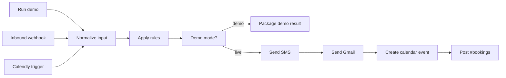

# Appointment booking with SMS and email reminders

> Portfolio demo only. This workflow is an original example for demonstration. It is not client work and it does not represent a deployment for any customer.

| | |
| --- | --- |
| Category | `booking` |
| Difficulty | intermediate |
| Apps | Calendly, Twilio, Gmail, Google Calendar, Slack |
| Time saved | Two reminders per booking, about 4 minutes, and fewer empty calls |
| Demo status | Run **Run demo** in n8n. The live apps stay on the false branch until you send `demo: false`. |

## Problem

People book and forget. The no-show is discovered when the host is already on the call alone.

## Who it is for

Consultants and agencies who book through Calendly or Cal.com and still remind people by hand.

## What the workflow does

A Calendly or Cal.com booking is turned into a 24-hour and a 2-hour reminder plan. SMS goes out when a phone exists, email otherwise. The calendar node can mirror the hold, and Slack sees the booking.

The checked-in sample is the contract. **Apply rules** turns that payload into a `summary`, a `route`, a `record` for the destination apps, and an `actions` list describing each write the live branch would make. **Package demo result** returns that object when `demo` is true, which is the default.

## Estimated time saved

Two reminders per booking, about 4 minutes, and fewer empty calls. The figure assumes the sample's volume and a person who currently does the same triage by hand. It is a planning number for a portfolio review, not a measured client result.

## Node by node

1. **Overview.** Sticky note with the portfolio-demo disclaimer and how to run the offline path.
2. **Run demo.** Manual trigger used by the editor and by `n8n execute`. With no payload, the next node loads the sample.
3. **Inbound webhook.** Production-style POST webhook at `/webhook/appointment-booking-reminders`. Responds with the last node's JSON.
4. **Calendly trigger.** Calendly trigger for invitee created and canceled. Cal.com bookings can use the inbound webhook.
5. **Normalize input.** Fills any missing fields from the checked-in sample and forces an explicit demo flag. An empty manual run therefore always has something valid to score.
6. **Apply rules.** Builds two reminder timestamps from the start time. Channel is SMS because the sample has a phone.
7. **Demo mode?.** Routes to the offline result while `demo` is true. The live apps run only when a caller sends demo:false.
8. **Package demo result.** Shapes the object returned to the editor, the CLI, and the webhook: summary, route, record, and the actions the live branch would have taken.
9. **Send SMS.** Sends the SMS (or places the call) using the phone and message on the record.
10. **Send Gmail.** Gmail send using the subject and body on the record.
11. **Create calendar event.** Creates the calendar event from record.start and record.end.
12. **Post #bookings.** Posts slackText to #bookings.

## Diagram



## Sample input

Save as the webhook body, or rely on the manual trigger, which loads the same object from **Normalize input**.

```json
{
  "demo": true,
  "email": "nora@brightline.example",
  "phone": "+15555550123",
  "title": "Ops audit with Brightline",
  "start": "2026-12-02T15:00:00.000Z",
  "end": "2026-12-02T15:30:00.000Z",
  "status": "booked"
}
```

The file next to this README, `sample-input.json`, is the same payload.

## Setup

1. Import `workflow.json` with n8n's Import from File. The workflow arrives inactive.
2. Select **Run demo** and execute it. **Package demo result** returns `status: demo_ready` plus the summary, route, record, and actions.
3. Create each credential listed below in n8n and choose it on the matching node. The `PLACEHOLDER_*` ids are labels, not secrets.
4. Replace every `YOUR_*` resource id (sheet, channel, list, parent page, calendar) with a resource you own.
5. Optional HTTP check: POST `sample-input.json` to `/webhook/appointment-booking-reminders` while the workflow is published. The default `demo: true` flag stays on the offline path.
6. Connect the live apps, send the same JSON with `"demo": false`, confirm one real record, then publish.

## Credentials

- **Calendly account** (`calendlyOAuth2Api`), placeholder id `PLACEHOLDER_CALENDLYOAUTH2API`
- **Twilio account** (`twilioApi`), placeholder id `PLACEHOLDER_TWILIOAPI`
- **Gmail account** (`gmailOAuth2`), placeholder id `PLACEHOLDER_GMAILOAUTH2`
- **Google Calendar account** (`googleCalendarOAuth2Api`), placeholder id `PLACEHOLDER_GOOGLECALENDAROAUTH2API`
- **Slack account** (`slackOAuth2Api`), placeholder id `PLACEHOLDER_SLACKOAUTH2API`

Placeholder ids are not real credentials. n8n will show them as missing until you create a credential of that type and select it on the node. Do not paste production secrets into the workflow JSON.

## Customization

- Cal.com can POST the same shape to the inbound webhook if you do not use the Calendly trigger.
- Stop both reminders when status flips to canceled. The route becomes reschedule.
- Convert reminder offsets to the guest's timezone before you send the SMS.
- A cancellation should stop the remaining reminders. The route field is there for that branch.

## Demo mode and the live branch

- Execute **Run demo** or POST the sample to `/webhook/appointment-booking-reminders` with `demo` omitted or true. The run stops after **Package demo result**.
- POST the same JSON with `"demo": false` only after every placeholder credential on the live branch has been replaced.
- The rules engine is intentionally local so the workflow can be reviewed and tested without buying model or SaaS credits. When you want a live model, put it on the live branch in front of the app nodes, or replace **Apply rules** with an Information Extractor / AI Agent and keep the same output shape.

## Portfolio note

Built as a portfolio demo for Mustafa ([mustafaautomation](https://github.com/mustafaautomation)). Public demos live under `*.quvantic.com`. Vendor names belong to their owners. Nothing in this folder is a customer deliverable.
