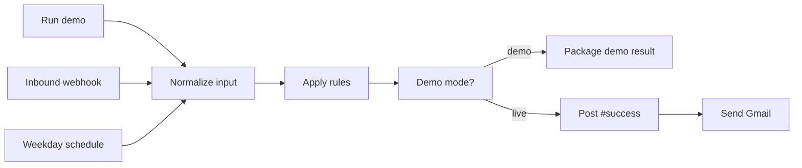

# Weekly churn-risk note

> Portfolio demo only. This workflow is an original example for demonstration. It is not client work and it does not represent a deployment for any customer.

| | |
| --- | --- |
| Category | `reporting` |
| Difficulty | advanced |
| Apps | Schedule, Slack, Gmail |
| Time saved | The weekly at-risk pass, about 30 minutes of list making |
| Demo status | Run **Run demo** in n8n. The live apps stay on the false branch until you send `demo: false`. |

## Problem

Churn shows up as a cancelled subscription, which is too late for a call.

## Who it is for

Customer-success owners with a small book of accounts.

## What the workflow does

Accounts flagged at-risk are counted and the note names how many need a call this week.

The checked-in sample is the contract. **Apply rules** turns that payload into a `summary`, a `route`, a `record` for the destination apps, and an `actions` list describing each write the live branch would make. **Package demo result** returns that object when `demo` is true, which is the default.

## Estimated time saved

The weekly at-risk pass, about 30 minutes of list making. The figure assumes the sample's volume and a person who currently does the same triage by hand. It is a planning number for a portfolio review, not a measured client result.

## Node by node

1. **Overview.** Sticky note with the portfolio-demo disclaimer and how to run the offline path.
2. **Run demo.** Manual trigger used by the editor and by `n8n execute`. With no payload, the next node loads the sample.
3. **Inbound webhook.** Production-style POST webhook at `/webhook/churn-risk-weekly`. Responds with the last node's JSON.
4. **Weekday schedule.** Schedule trigger for the recurring version of this workflow. Tests start from Run demo instead.
5. **Normalize input.** Fills any missing fields from the checked-in sample and forces an explicit demo flag. An empty manual run therefore always has something valid to score.
6. **Apply rules.** Counts at-risk, saved, and churned. The call list itself should stay in the sheet that produced the rows.
7. **Demo mode?.** Routes to the offline result while `demo` is true. The live apps run only when a caller sends demo:false.
8. **Package demo result.** Shapes the object returned to the editor, the CLI, and the webhook: summary, route, record, and the actions the live branch would have taken.
9. **Post #success.** Posts slackText to #success.
10. **Send Gmail.** Gmail send using the subject and body on the record.

## Diagram



## Sample input

Save as the webhook body, or rely on the manual trigger, which loads the same object from **Normalize input**.

```json
{
  "demo": true,
  "period": "2026-W47",
  "rows": [
    {
      "atRisk": 4,
      "saved": 1,
      "churned": 1
    }
  ],
  "previous": {
    "atRisk": 3,
    "saved": 2,
    "churned": 0
  }
}
```

The file next to this README, `sample-input.json`, is the same payload.

## Setup

1. Import `workflow.json` with n8n's Import from File. The workflow arrives inactive.
2. Select **Run demo** and execute it. **Package demo result** returns `status: demo_ready` plus the summary, route, record, and actions.
3. Create each credential listed below in n8n and choose it on the matching node. The `PLACEHOLDER_*` ids are labels, not secrets.
4. Replace every `YOUR_*` resource id (sheet, channel, list, parent page, calendar) with a resource you own.
5. Optional HTTP check: POST `sample-input.json` to `/webhook/churn-risk-weekly` while the workflow is published. The default `demo: true` flag stays on the offline path.
6. Connect the live apps, send the same JSON with `"demo": false`, confirm one real record, then publish.

## Credentials

- **Slack account** (`slackOAuth2Api`), placeholder id `PLACEHOLDER_SLACKOAUTH2API`
- **Gmail account** (`gmailOAuth2`), placeholder id `PLACEHOLDER_GMAILOAUTH2`

Placeholder ids are not real credentials. n8n will show them as missing until you create a credential of that type and select it on the node. Do not paste production secrets into the workflow JSON.

## Customization

- Do not put customer names in the Slack post if the channel is wide. Keep names in the email.
- Send the narrative and attach the totals object. People read the sentence and audit the numbers.
- Keep the comparison period in the payload so the same workflow works for daily and weekly runs.

## Demo mode and the live branch

- Execute **Run demo** or POST the sample to `/webhook/churn-risk-weekly` with `demo` omitted or true. The run stops after **Package demo result**.
- POST the same JSON with `"demo": false` only after every placeholder credential on the live branch has been replaced.
- The rules engine is intentionally local so the workflow can be reviewed and tested without buying model or SaaS credits. When you want a live model, put it on the live branch in front of the app nodes, or replace **Apply rules** with an Information Extractor / AI Agent and keep the same output shape.

## Portfolio note

Built as a portfolio demo for Mustafa ([mustafaautomation](https://github.com/mustafaautomation)). Public demos live under `*.quvantic.com`. Vendor names belong to their owners. Nothing in this folder is a customer deliverable.
