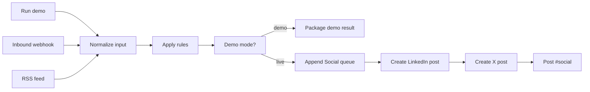

# Repurpose a blog or YouTube piece into LinkedIn and X drafts

> Portfolio demo only. This workflow is an original example for demonstration. It is not client work and it does not represent a deployment for any customer.

| | |
| --- | --- |
| Category | `social` |
| Difficulty | intermediate |
| Apps | RSS, LinkedIn, X, Slack, Google Sheets |
| Time saved | About 40 minutes per source that currently gets rewritten by hand |
| Demo status | Run **Run demo** in n8n. The live apps stay on the false branch until you send `demo: false`. |

## Problem

A blog post or a YouTube transcript is published once. The LinkedIn and X versions are a task that slips.

## Who it is for

Founders and freelance marketers who publish long-form and want the short versions the same day.

## What the workflow does

A long source is cut into a LinkedIn draft, a short X draft, and a three-beat carousel. The drafts are logged and posted to Slack for approval. Nothing publishes itself.

The checked-in sample is the contract. **Apply rules** turns that payload into a `summary`, a `route`, a `record` for the destination apps, and an `actions` list describing each write the live branch would make. **Package demo result** returns that object when `demo` is true, which is the default.

## Estimated time saved

About 40 minutes per source that currently gets rewritten by hand. The figure assumes the sample's volume and a person who currently does the same triage by hand. It is a planning number for a portfolio review, not a measured client result.

## Node by node

1. **Overview.** Sticky note with the portfolio-demo disclaimer and how to run the offline path.
2. **Run demo.** Manual trigger used by the editor and by `n8n execute`. With no payload, the next node loads the sample.
3. **Inbound webhook.** Production-style POST webhook at `/webhook/social-content-repurposing`. Responds with the last node's JSON.
4. **RSS feed.** RSS trigger. Set the feed URL on the node before publishing the workflow.
5. **Normalize input.** Fills any missing fields from the checked-in sample and forces an explicit demo flag. An empty manual run therefore always has something valid to score.
6. **Apply rules.** Takes the first sentence as the LinkedIn hook, trims an X variant to 240 characters, and numbers three beats for a carousel.
7. **Demo mode?.** Routes to the offline result while `demo` is true. The live apps run only when a caller sends demo:false.
8. **Package demo result.** Shapes the object returned to the editor, the CLI, and the webhook: summary, route, record, and the actions the live branch would have taken.
9. **Append Social queue.** Appends the record to the Social queue tab. Map columns explicitly once the sheet exists.
10. **Create LinkedIn post.** Publishes the LinkedIn variant of the drafted copy.
11. **Create X post.** Publishes the short X variant of the drafted copy.
12. **Post #social.** Posts slackText to #social.

## Diagram



## Sample input

Save as the webhook body, or rely on the manual trigger, which loads the same object from **Normalize input**.

```json
{
  "demo": true,
  "title": "What a 60-second lead response changes",
  "url": "https://example.com/blog/speed-to-lead",
  "body": "Teams that answer a new lead inside a minute book more meetings. The rest send a careful email tomorrow. A named owner matters as much as the speed.",
  "transcript": "Teams that answer a new lead inside a minute book more meetings. The rest send a careful email tomorrow. A named owner matters as much as the speed."
}
```

The file next to this README, `sample-input.json`, is the same payload.

## Setup

1. Import `workflow.json` with n8n's Import from File. The workflow arrives inactive.
2. Select **Run demo** and execute it. **Package demo result** returns `status: demo_ready` plus the summary, route, record, and actions.
3. Create each credential listed below in n8n and choose it on the matching node. The `PLACEHOLDER_*` ids are labels, not secrets.
4. Replace every `YOUR_*` resource id (sheet, channel, list, parent page, calendar) with a resource you own.
5. Optional HTTP check: POST `sample-input.json` to `/webhook/social-content-repurposing` while the workflow is published. The default `demo: true` flag stays on the offline path.
6. Connect the live apps, send the same JSON with `"demo": false`, confirm one real record, then publish.

## Credentials

- **Google Sheets account** (`googleSheetsOAuth2Api`), placeholder id `PLACEHOLDER_GOOGLESHEETSOAUTH2API`
- **LinkedIn account** (`linkedInOAuth2Api`), placeholder id `PLACEHOLDER_LINKEDINOAUTH2API`
- **X account** (`twitterOAuth2Api`), placeholder id `PLACEHOLDER_TWITTEROAUTH2API`
- **Slack account** (`slackOAuth2Api`), placeholder id `PLACEHOLDER_SLACKOAUTH2API`

Placeholder ids are not real credentials. n8n will show them as missing until you create a credential of that type and select it on the node. Do not paste production secrets into the workflow JSON.

## Customization

- Leave the LinkedIn and X nodes disabled until a person has edited the draft in the sheet.
- YouTube RSS works as the trigger. The transcript field is what the rules read when the title is not enough.
- Scheduling is a status on the record. A later workflow can publish rows whose status moved from draft to approved.
- Leave posts in draft. Scheduling belongs to a human or to a later approval step.
- Trim the X variant to 240 characters inside the rules node before it reaches the X node.

## Demo mode and the live branch

- Execute **Run demo** or POST the sample to `/webhook/social-content-repurposing` with `demo` omitted or true. The run stops after **Package demo result**.
- POST the same JSON with `"demo": false` only after every placeholder credential on the live branch has been replaced.
- The rules engine is intentionally local so the workflow can be reviewed and tested without buying model or SaaS credits. When you want a live model, put it on the live branch in front of the app nodes, or replace **Apply rules** with an Information Extractor / AI Agent and keep the same output shape.

## Portfolio note

Built as a portfolio demo for Mustafa ([mustafaautomation](https://github.com/mustafaautomation)). Public demos live under `*.quvantic.com`. Vendor names belong to their owners. Nothing in this folder is a customer deliverable.
